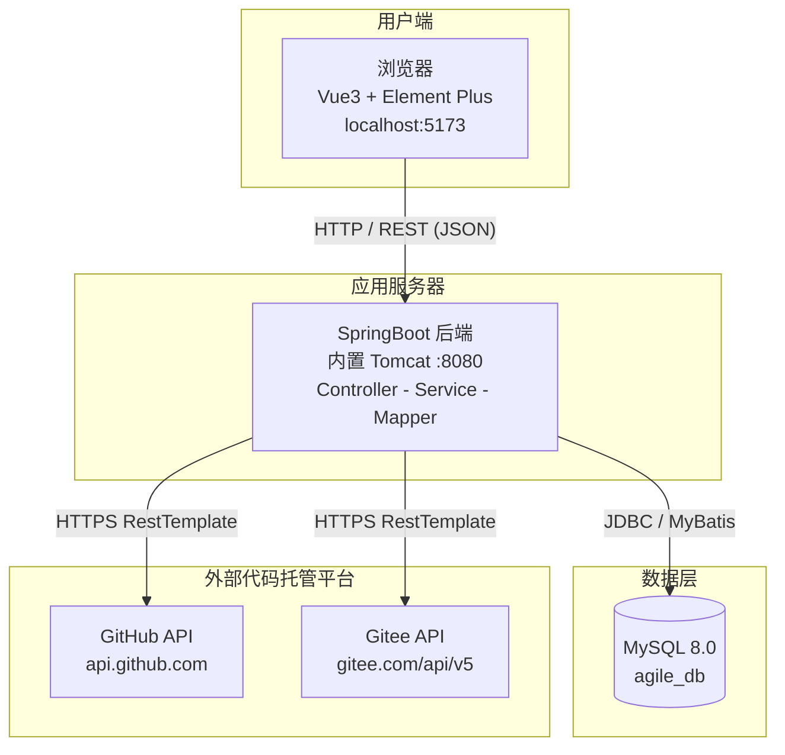

# Sprint 2｜第二次课：架构与概要设计

本阶段搭建工程骨架、进行模块划分和架构设计。

## 架构选型

- 前端：Vue3 + Element Plus
- 后端：SpringBoot + MyBatis + MySQL
- 架构：前后端分离，模块化单体

## 模块划分

- module_a：登录、项目、成员管理
- module_b：Sprint迭代管理
- module_c：用户故事、Backlog、变更记录
- module_d：报表、快照、GitHub适配器

## 架构分层

- Controller：接口层
- Service：业务逻辑层
- Mapper：持久层
- DTO：请求入参
- VO：返回视图对象

## 部署图（系统拓扑）

系统采用前后端分离部署：前端为 Vue3 静态资源（开发态 Vite :5173），后端为 SpringBoot 单体应用（内置 Tomcat :8080），数据存于本机 MySQL 8.0 的 agile_db；后端通过 module_d 的适配器以 HTTPS 访问外部 GitHub / Gitee 开放 API，形成与外部代码仓库的集成边界。

PlantUML 源文件：`docs/sprint2_design/plantuml/deployment.puml`

## 需要小组确认

1. 全部表结构、枚举是否与sprint1需求对齐；
2. 对外公共接口入参出参确认；
3. 所有人本地可以正常启动工程。
